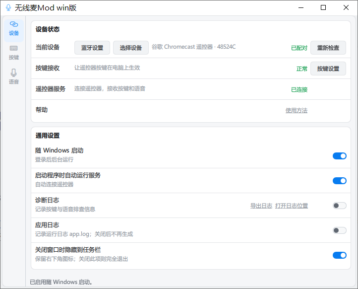
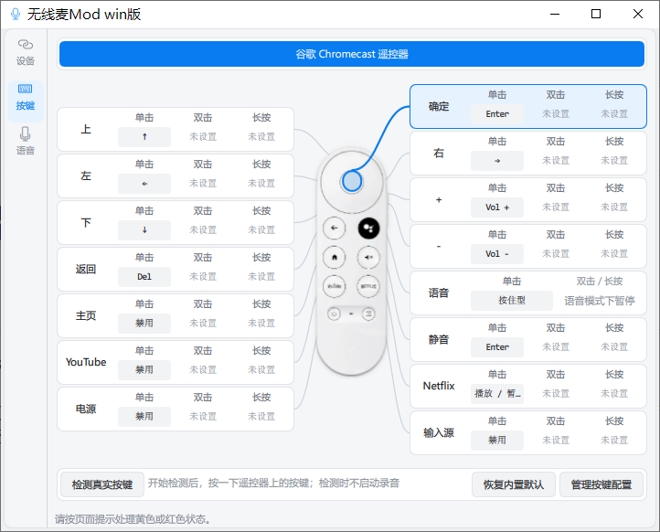
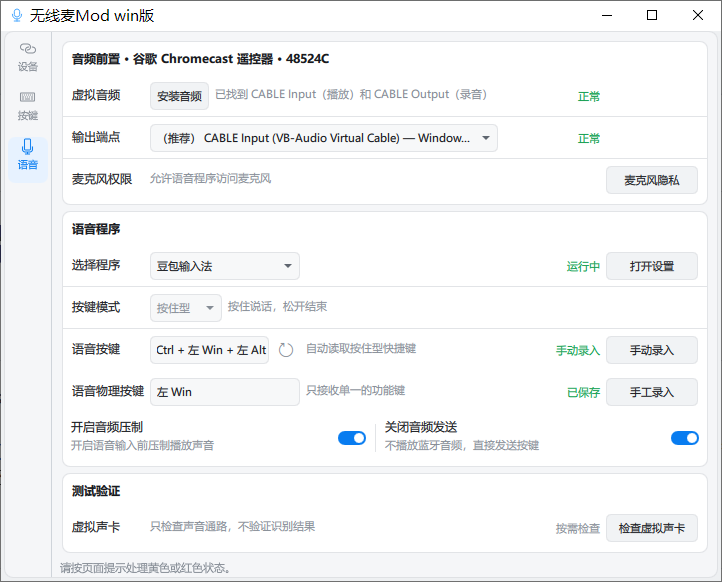

# 无线麦【Win版】· 谷歌 Chromecast 遥控器

把谷歌 Chromecast 语音遥控器的按键和麦克风变成 Windows 快捷操作与语音输入工具，可远距离
控制应用、输入文字和触发 Quicker 动作。

本仓库是 [`ZSTDJan/windows-remote-mic-app`](https://github.com/ZSTDJan/windows-remote-mic-app)
的一个分支，**只保留谷歌 Chromecast 遥控器链路**，不分发小米遥控器（RC003）的代码与素材，
也不含上游的 macOS 部分。来源与改动说明见 [`ATTRIBUTION.md`](ATTRIBUTION.md)。

支持按键单击、双击、长按映射，可配合搜狗、微信、豆包和 Chatterfly 使用。

当前版本 `0.1`（`src/ovb/VERSION`）。上游基线为 `v1.0.91`（commit `f238a19`）——本分支是
独立的发布序列，版本号不沿用上游。

> **说明：本分支以源码形式发布，没有安装包。** 需要按下面的「从源码运行」自己装依赖。

## 界面截图

| 通用设置页 | 按键映射页 |
| --- | --- |
|  |  |

语音页包含虚拟声卡、语音按键（截图示例为 `Ctrl + 左Win + 左Alt`）、允许语音程序访问麦克风，
以及「关闭音频发送」开关。



## 本分支相对上游的改动

本分支在 [`ZSTDJan/windows-remote-mic-app`](https://github.com/ZSTDJan/windows-remote-mic-app)
`v1.0.91` 的基础上重新梳理了源代码逻辑，**移除了小米遥控器（RC003）的全部代码与素材**，
只保留谷歌 Chromecast 遥控器链路，并做了以下功能增删与稳定性改进。

> 为什么只留谷歌遥控器：一台小米遥控器的价格约等于四台谷歌遥控器；小米遥控器在高频使用
> 场景下不到 10 天就要充电，而谷歌遥控器用两节 7 号电池即可，价廉物美，键盘布局也更好。

新增与调整：

- **应用日志开关** — 可单独开关旋转日志 `app.log`（默认开）与按键／语音诊断日志
  （默认关），不再必须一直写盘。
- **自启动改用计划任务** — 目的是**提权**：部分权限更高的应用若不以管理员身份启动，
  语音输入无法注入按键。`Run` 注册表项无法提权，因此改用计划任务
  （`src/ovb/startup_windows.py`）。
- **「检测真实按键」按钮** — 点开后进入测试模式，可以逐个测试遥控器上的所有按键，
  再次点击按钮才退出（不再是一次性检测）。
- **语音物理按键** — 可指定键盘上一个单一功能键（如左 Win），长按它即可语音输入；
  长按期间再按其他键会组合成快捷键，因此**不影响组合键的正常使用**。
- **音频压制** — 豆包输入法自身没有音频压制，播放音频时使用输入法的会把播放声一起录进去。
  开启本功能后按下语音键会短暂静音，避免播放音频的回声被录入。其他输入法自带音频压制。
- **关闭音频发送** — 打开后不使用遥控器麦克风，改用外置麦克风；遥控器上所有按键不再
  需要等检测到麦克风才可用。
- **输出端点检测调整** — 无论是否使用推荐的输出端点，程序执行检查后只要正常就显示
  「正常」。

详细的改动说明与授权信息见 [`ATTRIBUTION.md`](ATTRIBUTION.md)。

## 能做什么

- 给遥控器按键设置方向、确认、音量、快捷键、鼠标操作或 Quicker 动作；同一按键可分别设置
  单击、双击和长按。
- 用遥控器话筒键说话，在文字输入框中使用搜狗、微信、豆包或 Chatterfly 输入文字。
- 在「管理按键配置」中复制、应用、重命名和删除配置副本，或导出／导入文件备份；当前映射
  始终自动保存。
- 在通知区域保持运行；关闭设置窗口通常会隐藏，结束程序请从通知区域选择「完全退出」。

## 从源码运行

环境：Windows 10 1809（build 17763）及以上，Python 3.14。Qt 与部分依赖只提供 Windows
wheel，非 Windows 平台只能跑纯逻辑的单元测试。

### 运行环境

实测通过的组合：**Windows 10（build 19045）+ Python 3.14.7**（CPython 官方 64 位安装包）。

Python 版本要求是 **3.14**，不是「3.14 及以上都可以」——依赖 wheel 与 `asyncio`、
`ctypes` 行为都按这个版本验证过，换成 3.13 或 3.15 没有跑过测试。

必须安装的依赖见 [`requirements.txt`](requirements.txt)，版本必须一致（Qt 与 PySide6
的版本要对应，改动任一版本都要同步更新 `THIRD_PARTY_NOTICES.md` 与
`THIRD_PARTY_SOURCE.md`）：

| 依赖 | 版本 | 用途 |
| --- | --- | --- |
| PySide6-Essentials | 6.12.0 | Qt 界面 |
| shiboken6 | 6.12.0 | PySide6 绑定生成器 |
| numpy | 2.5.1 | 音频缓冲处理 |
| sounddevice | 0.5.6 | 音频采集与播放 |
| frida | 17.24.0 | 豆包输入法的进程内注入 |
| comtypes | 1.4.17 | COM 接口 |
| uiautomation | 2.0.29 | UI 自动化 |
| pefile | 2024.8.26 | PE 文件解析 |

```powershell
py -3.14 -m pip install -r requirements.txt
$env:PYTHONPATH = Join-Path (Get-Location) 'src'
$env:PYTHONUTF8 = '1'
python -m ovb --settings
```

`$env:PYTHONUTF8 = '1'` 不是可选项：界面文案和配置文件都是 UTF-8，不设这个环境变量，
Windows 下中文会按 GBK 解码而乱码。

仓库根下已备好两个 `.bat`：

- `启动无线麦源码版.bat` — 普通启动，打开设置窗口。
- `启动无线麦源码版-提权.bat` — 以管理员权限启动。**语音键必须用这个。**

### 为什么必须提权

程序用 `keybd_event` 注入语音快捷键。Windows UIPI 会丢弃从低完整性级别发往高完整性级别
进程的合成输入，而豆包等目标程序常以高完整性级别运行。因此本程序自己也必须以同等或更高
完整性级别运行，否则语音键发不出去。这不是配置问题，`Run` 注册表项永远做不到提权，提权
自启动只能走计划任务。

### 命令行

```
python -m ovb              打开设置窗口（默认）
python -m ovb --settings   打开设置窗口
python -m ovb --background 后台启动，只在通知区域
python -m ovb --bridge     后台启动并运行 bridge
python -m ovb --dry-run    导入每个模块后退出 0（CI 冒烟检查）
python -m ovb --version    打印版本号后退出
```

## 第一次使用

- **首次配置前，请先暂时退出 360 等杀毒软件；配置和测试完成后及时恢复防护。**
- **首次使用语音前，必须先安装虚拟音频组件 VB-CABLE，并重启电脑；重启后再配置语音。**
- 开发环境为 Windows 10（build 19045）。较早 Windows 版本的兼容性尚未全面验证。

### 先让遥控器按键可用

1. 在 Windows 蓝牙设置中配对遥控器。
2. 打开无线麦，进入「设备」页。
3. 点「选择设备」，选中刚配对的遥控器并点「使用此设备」。
4. 点「启动服务」，查看连接状态；如有未就绪提示，按页面说明处理。
5. 连接后按一次方向键，确认能控制电脑。

需要自定义按键时：到「按键」页选择要修改的按键，分别设置单击、双击或长按动作，点
「完成」保存。

### 再设置语音输入

**语音需要在无线麦和对应输入法两边分别配置，只设置无线麦还不够。**

1. 在「语音」页点击「安装音频」，安装虚拟音频组件 VB-CABLE，**安装完成后先重启电脑**。
2. 重启后，在无线麦「语音」页选择搜狗、微信、豆包或 Chatterfly。
3. 在无线麦中，把「输出端点」设为 `CABLE Input`。
4. 打开对应输入法或 Chatterfly 的设置，把麦克风设为 `CABLE Output`。
5. 在无线麦中确认「按键模式」：谷歌遥控器支持按住型和开关型。
6. **检查「设置 → 隐私和安全性 → 语音」已开启。** 这一项关掉的话，Windows 语音识别本身
   不工作，语音键整条链路直接失效；程序会给出打开该设置页的入口，但不会替你改。

搜狗、微信和豆包还需要配置语音快捷键：

1. 在输入法设置中，为所选语音模式设置快捷键。
2. 让无线麦的「语音按键」与输入法中的设置一致；自动读取失败可手动录入。
3. 打开记事本，把光标放在文字框里，用电脑键盘测试该快捷键，确认能录音和输入文字。

**Chatterfly：** 麦克风仍需按上面的基础设置选择 `CABLE Output`；无线麦直接控制录音，
无需靠快捷键启动，界面中的快捷键供键盘对照。

最后把光标放在文字框里，用遥控器话筒键测试：按住型按住说话、松开结束；开关型按一次开始，
再按一次结束。

快捷键注意（搜狗、微信和豆包）：避开 Windows 和其它软件已占用的组合键；按住型录音期间，
语音快捷键会保持按下，松开话筒键才释放。

### 「关闭音频发送」开关

设备页 → 通用设置里有一个「关闭音频发送」开关（设置项 `disable_audio_sending`，默认关）。
打开后，程序不再打开音频发送端点，按下语音键时直接发按键，并在更早的阶段丢弃 BLE 音频，
以节省系统资源。开关在每次按键时重读，不需要重启。

**已知后果：** 该开关打开时，豆包等自带录音结束判定的输入法会在自己判定静音超时后结束
录音，程序随后把这次按键判为失败并释放语音键，表现为「按一次能用，后面怎么按都呼不出
输入法」。这不是开关本身失效——按键确实发出去了——而是「发按键但不发音频」这个语义对
豆包不成立。要正常使用语音输入，请保持该开关关闭。

## Known gaps

源码中多处 docstring 引用本节。下面每条都是**尚未实测确认**的部分，不是已实现的功能
列表。

1. **没有真机端到端验证的边界。** 本仓库及其测试里不存在任何设备配对／控制行为，这是
   项目的硬性边界（`src/ovb/app.py` 模块 docstring）。遥控器已做过本机独立按键、语音和
   开关控制验证，产品接收尚未接入，当前只支持设备选择与配置隔离
   （`config/chromecast-remote.json` 的 `support.notes`）。

2. **Raw Input 事件形态未在本设备上确认。** Windows 投递 Raw Input 有两种形态
   （`src/ovb/raw_input_windows.py`）：`RIM_TYPEKEYBOARD` 是已翻译的键盘事件（VK + 上下
   键标志），`RIM_TYPEHID` 是原始未翻译的报告字节。这个 BLE HID-over-GATT 集合在本设备
   上实际走哪一种，**没有对真机验证过**。前者覆盖有标准或实测 Windows VK 翻译的按键
   （方向、Enter、Home、Application/Menu、话筒键作 F5、TV 作 OEM_3、电源作 Sleep、三个
   键盘页音量 usage）；「返回」键的 usage `0x00F1` 已知落在翻译范围之外，可能完全不出
   事件——这是安全的惰性失败（该键无反应）而不是崩溃。后者作为纵深防御保留，永不触发
   也无害。

3. **HID 报告形状与「返回」键的 Windows 兼容性缺口。** 报告为 9 字节：3 字节的
   HID-over-GATT report-id 前缀 + 6 字节的三个小端 uint16 键盘页 usage 槽位（0 表示空槽）
   （`src/ovb/hid_identity.py`）。Windows 对 `0x00F1` 没有标准翻译，这是上游自己的研究
   结论，本分支沿用。

4. **元素导航子系统（OrthoFocus 源码副本）未在本链路中接线。** `src/ovb/script/` 下 6 个
   模块是从上游独立项目 [`ZSTDJan/orthofocus`](https://github.com/ZSTDJan/orthofocus)
   导入的副本。它们不 import `ovb`、不使用 `REMOTE_MIC_*` 环境变量，隔离性由
   `tests/test_element_navigation_export.py` 断言。导出脚本与模板不在本仓库，相关导出测试
   会自动 skip。

5. **Windows 版本下限是自我声明，不是实测。** `MIN_SUPPORTED_BUILD = 17763`
   （Windows 10 1809）沿用上游 installer 的 `MinVersion` 声明（`src/ovb/windows_diagnostics.py`），
   较早版本的兼容性没有全面验证。

6. **Frida HID tap 只在需要时启用。** `src/ovb/frida_assets/` 里的 Frida Gadget 压缩包
   （7 MB）随仓库分发，SHA-256 由 `src/ovb/frida_hid_tap_runtime.py` 校验后才使用；它只
   用于补回 Windows 不翻译的 `back` / `volume_up` / `volume_down` 三个键。不需要这三个键
   的用户不会加载它。

## 测试

```powershell
python scripts/run_tests.py -j 4 --no-confirm
```

本机基线（Python 3.14.7，Windows 10）：**3510 个测试，failing=0，flaky=0，crashed=0**，
耗时约 104 秒。runner 只用标准库，不需要 pytest。全部用例跑完后不要加
`REMOTE_MIC_DEV_SESSION=1`，那会造成约 122 个假失败。

## 开源与安全

代码按 [GPL-3.0-only](LICENSE.md) 发布；第三方组件和素材按各自的许可与授权使用，见
[第三方说明](THIRD_PARTY_NOTICES.md)、[对应源码](THIRD_PARTY_SOURCE.md) 和
[素材授权](ASSET_LICENSES.md)。普通问题与建议见 [参与说明](CONTRIBUTING.md)，安全漏洞请
通过 [私密报告入口](SECURITY.md) 提交，不要在公开 Issue 里贴蓝牙地址、HID 路径、用户
配置或未脱敏日志。
